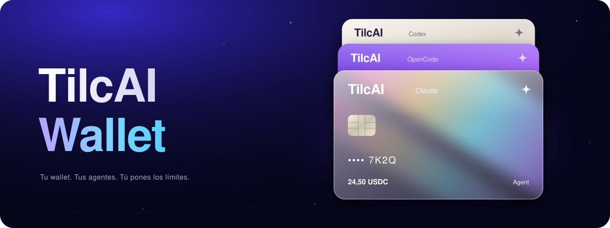
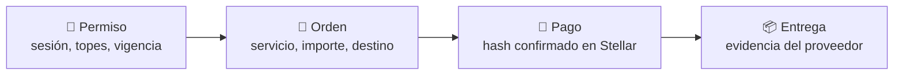
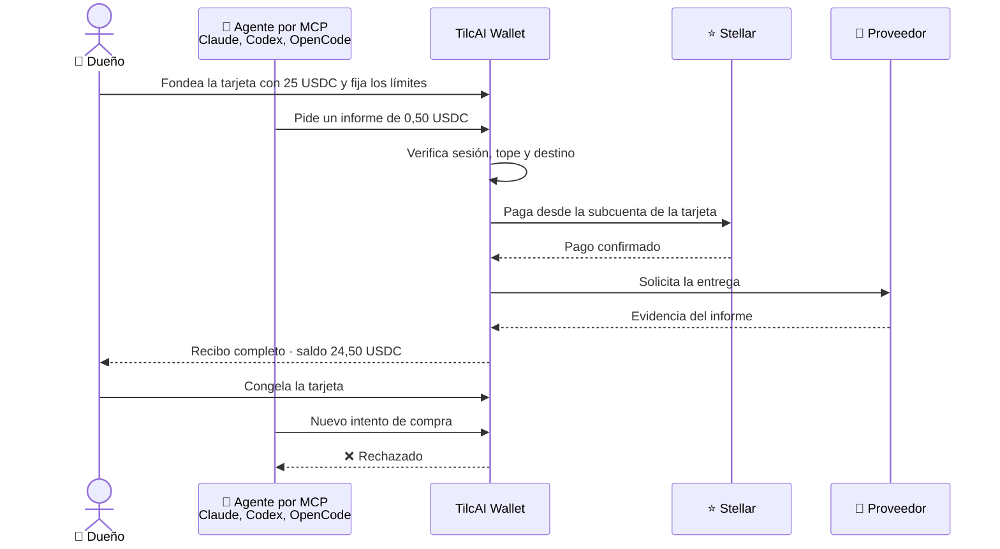
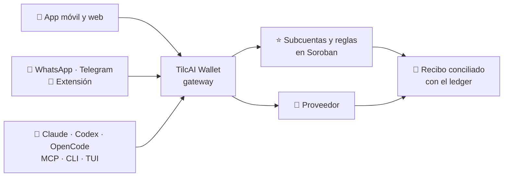

<p align="center">
  
</p>

<p align="center">
  
  
  
  
  
</p>

<h3 align="center">Tus agentes compran. Tú sabes qué autorizaste, cuánto pagaron y qué recibiste.</h3>

TilcAI Wallet permite conectar **cualquier agente de IA** (Claude, Codex, OpenCode o cualquier cliente MCP), fondear una **tarjeta** para su sesión y controlar sus compras desde el celular. Cada recibo vincula el permiso del dueño, la orden, el pago confirmado en Stellar y la evidencia de lo que entregó el proveedor. Y todo se ve igual desde la app, la web, WhatsApp, Telegram, la extensión o la terminal.

> [!NOTE]
> **Proyecto en diseño e integración.** Las funciones descritas aquí son el objetivo del producto. La sección [Estado y validación](#-estado-y-validación) indica qué está comprobado en testnet.

---

## 🤔 El problema

Un agente de IA ya puede comprar un informe o consumir una API de pago en segundos. Lo difícil viene después, cuando el negocio tiene que responder:

| ❓ | La pregunta | Dónde suele quedar la respuesta |
| :---: | --- | --- |
| 🔐 | ¿Quién autorizó este gasto? | En la configuración de algún cliente |
| 📝 | ¿Qué pidió el agente? | En el historial de una conversación |
| 💸 | ¿A quién se pagó y cuánto? | En una transacción en cadena |
| 📦 | ¿Qué se recibió a cambio? | En el sistema del proveedor |

Con varios agentes, varias sesiones y varios proveedores, esa información queda repartida. **TilcAI Wallet la reúne en un solo recibo.**

## ⚡ Cómo funciona

| Paso | | Qué haces |
| :---: | :---: | --- |
| **1** | 🔌 **Conecta** | Vincula una instalación de tu agente (Claude, Codex, OpenCode…) y aprueba su sesión desde la wallet. |
| **2** | 💳 **Fondea** | Pasa saldo de tu cuenta principal a la tarjeta del agente. Fija el máximo por compra, el tope acumulado, los destinos admitidos y el vencimiento. |
| **3** | 🧾 **Revisa** | Sigue la orden, el pago en Stellar y la evidencia de entrega desde la actividad de la tarjeta. |
| **4** | 🛑 **Controla** | Desde el móvil, cierra una sesión, congela nuevas compras o revoca el permiso y recupera el remanente. |

## 🌐 Todos tus agentes, todos tus canales

### 🤖 Agentes

Cada instalación de un agente es una sesión con su propia tarjeta. Si usas Claude en la oficina y Codex en el portátil, cada uno gasta solo de lo suyo.

| Agente | Cómo se conecta |
| --- | --- |
| **Claude** | Servidor MCP de TilcAI |
| **Codex** | Servidor MCP de TilcAI |
| **OpenCode** | Servidor MCP de TilcAI |
| **Cualquier otro agente** | Configuración MCP genérica. Aparece en la wallet como *cliente personalizado* |

### 📡 Canales

Una sola wallet, el mismo saldo y el mismo recibo, entres por donde entres. Las acciones sensibles (fondear, cambiar límites, revocar) siempre se aprueban con la passkey del dueño.

| Canal | Qué haces ahí | Estado |
| --- | --- | :---: |
| 📱 **App móvil** | Centro de control: fondear, congelar, revocar y aprobar con passkey | 🟢 Primera integración (web móvil instalable) |
| 🌐 **App web** | Saldo, sesiones, tarjetas y recibos desde el escritorio | 🟢 Primera integración |
| 🤖 **MCP** | El agente consulta su tarjeta, compra y recupera recibos | 🟢 Primera integración |
| 💬 **WhatsApp** | Iniciar el alta, recibir avisos y saltar al panel para aprobar | 🟡 Hoja de ruta, sujeto a las políticas de Meta |
| ✈️ **Telegram** | Bot y Mini App para alta, estado y avisos | 🟡 Hoja de ruta |
| 🧩 **Extensión de navegador** | Conectar sitios con permisos por origen | 🟡 Hoja de ruta |
| ⌨️ **CLI** | Estado, extracto y recibos desde la terminal | 🟡 Hoja de ruta |
| 🖥️ **TUI** | Vista interactiva de saldo, tarjetas y actividad en terminal | 🟡 Hoja de ruta |

### 🪪 Una tarjeta por sesión de agente

Cada sesión habilitada para gastar tiene **su propia subcuenta Stellar**. El agente solo puede gastar lo que hay en su tarjeta, y dos instalaciones del mismo agente operan con presupuestos independientes. La vista principal consolida los saldos y conserva el disponible de la cuenta principal.

```text
Wallet · 49,50 USDC en tarjetas

┌ Claude · Investigación ────────── Activa ┐
│ 24,50 USDC de 25,00 · Máx. 0,50/compra   │
└──────────────────────────────────────────┘
┌ Codex · Portátil ──────────────── Activa ┐
│ 15,00 USDC de 15,00 · Máx. 1,00/compra   │
└──────────────────────────────────────────┘
┌ OpenCode · CI ──────────────── Congelada ┐
│ 10,00 USDC · Disponible para agente: 0   │
└──────────────────────────────────────────┘
```

### 🧭 Centro de sesiones

La vista **Sesiones** reúne en un solo lugar los accesos de la app y la web, los vínculos de WhatsApp y Telegram, y los clientes de agentes. Cada fila muestra cliente, instalación, estado y última actividad, y se puede cerrar por separado.

### 🔑 Control de acceso y gasto

- **La autoridad es tuya.** El dueño controla la cuenta con una passkey. El agente nunca la ve.
- **El agente firma dentro de un marco.** El firmante delegado de cada sesión solo opera dentro de las reglas de su subcuenta.
- **Tres niveles para detenerlo:**
  - **Cerrar el acceso** invalida la credencial del cliente.
  - **Congelar** bloquea nuevas solicitudes; el panel indica cuándo se confirma el cambio en Stellar.
  - **Revocar** retira el permiso de gasto y devuelve el saldo una vez conciliados los pagos pendientes.

## 🧾 Qué hace verificable una compra



| Evidencia | Qué permite revisar |
| --- | --- |
| **Permiso** | Sesión, tarjeta, proveedor admitido, topes y vigencia aprobados. |
| **Orden** | Servicio solicitado, importe y destinatario. |
| **Pago** | Activo, importe, red, hash y confirmación en Stellar. |
| **Entrega** | Referencia y estado del servicio reportado por el proveedor. |

Un pago confirmado no significa que el servicio llegó. Por eso la wallet distingue los estados:

**Pago pendiente** → **Pagado, pendiente de entrega** → **Entregado**

El recibo conserva el mismo identificador en todos los canales: lo pide el agente por MCP y lo abres después en el móvil.

## 🎬 Un ejemplo en testnet

Una agencia fondea **25 USDC de prueba** para la sesión **Claude · Investigación**, con un máximo de **0,50 USDC por informe** y un solo proveedor autorizado. El mismo flujo sirve para Codex, OpenCode o cualquier agente conectado por MCP.



Las comisiones se suponen patrocinadas fuera del saldo de la tarjeta.

## 🎯 Para quién

Para **agencias de software, fintechs y equipos** que delegan compras recurrentes de servicios digitales en agentes:

- 🔎 Informes de debida diligencia
- 🔌 Consultas a APIs de pago
- 🛠️ Herramientas por consumo

El valor se mide con **compras conciliadas**, **evidencia de entrega** y **el tiempo que toma revisar cada gasto**.

## 🏗️ Arquitectura



- **Stellar** aporta cuentas de contrato, liquidación y políticas de autorización.
- **El gateway** valida la sesión, coordina la orden y concilia la transacción con el proveedor.
- **Los canales** reciben eventos de actividad y muestran el estado a partir de confirmaciones del ledger, cada uno con los datos que su permiso admite.
- **Pagos:** se evalúa la compatibilidad de x402 con la subcuenta, con liquidación directa en testnet durante la validación.

📚 [Cuentas de contrato en Stellar](https://developers.stellar.org/docs/build/guides/contract-accounts) · [x402 en Stellar](https://developers.stellar.org/docs/build/agentic-payments/x402/quickstart-guide)

### 📦 Monorepo de producto

| Área | Responsabilidad |
| --- | --- |
| **Apps** | App web móvil, servidor MCP, bot y Mini App de Telegram, extensión, CLI y TUI. |
| **Servicios** | API, vinculación de canales, órdenes y conciliación. |
| **Paquetes** | Dominio wallet, contratos de API, SDK y adaptador a TilcAI. |
| **Contratos** | Integración de smart accounts y reglas de gasto en Soroban. |
| **Pruebas** | Aislamiento entre sesiones, liquidación, duplicados, congelación y recuperación. |

### 🧱 Construido sobre TilcAI

No partimos de cero. El producto reutiliza la base de **[TilcAI](https://github.com/TilcAI/tilcai-infrastructure)** para cuentas, WebAuthn, pagos x402, relayer y monitorización. El monorepo añade la experiencia de wallet, el ciclo de vida de sesiones y tarjetas, y la evidencia de compra. Las rutas de fondeo adicionales se habilitan después de verificar la red, el activo y la conciliación.

## 🚦 Estado y validación

**Primera validación:** reproducir un ciclo completo en Stellar testnet con la app web móvil y un agente por MCP.

- [ ] Desplegar y fondear una subcuenta
- [ ] Pagar desde MCP
- [ ] Consultar el recibo en el móvil
- [ ] Congelar la tarjeta y comprobar que se rechaza un nuevo intento
- [ ] Revocar el permiso y recuperar el remanente

**Siguiente etapa:** dos agentes con tarjetas independientes, reconexión de sesiones y los canales de la hoja de ruta. Cada canal se marca como disponible al completar sus pruebas.

## 🇧🇴 Stellar Bolivia

TilcAI Wallet participa en la **[National Startups Hackathon 2026](https://www.stellar-bolivia.xyz/)** de Stellar Bolivia como una herramienta de control y conciliación para equipos que compran servicios mediante agentes.

---

## 🌎 English summary

**TilcAI Wallet** is a Stellar wallet for accountable AI agent purchases. Any agent (Claude, Codex, OpenCode or any MCP client) gets a funded smart-account card per session, with its own limits. Owners manage sessions and spending from mobile, and the same wallet is reachable from web, WhatsApp, Telegram, a browser extension, MCP, CLI and TUI. Every purchase receipt links **permission → order → settlement → delivery**. The product is designed as a monorepo built on the existing TilcAI infrastructure.

<p align="center">
  <sub><i>Tu wallet. Tus agentes. Tú pones los límites.</i></sub>
</p>
