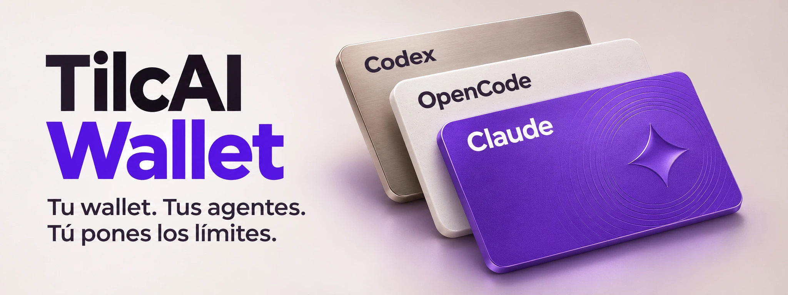
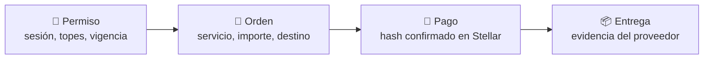
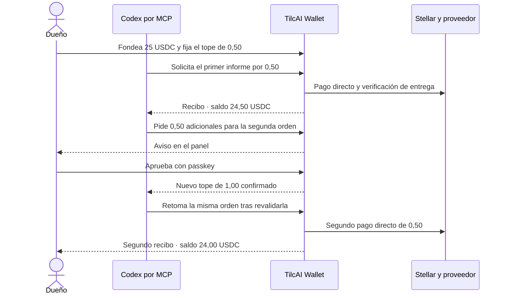
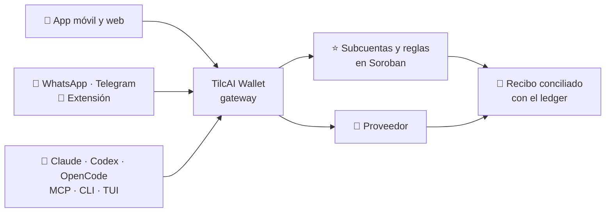

<p align="center">
  
</p>

<p align="center">
  
  
  
  
  
</p>

<h3 align="center">Tus agentes compran. Tú sabes qué autorizaste, cuánto pagaron y qué recibiste.</h3>

**TilcAI Wallet** reúne en un recibo verificable el permiso del dueño, la orden, el pago confirmado en Stellar y la evidencia de lo que entregó el proveedor. Cada sesión de agente tiene una tarjeta fondeada con su propia subcuenta. Si el agente alcanza su tope, puede pedir más presupuesto. El dueño decide con passkey desde el panel móvil.

> [!NOTE]
> **Proyecto en diseño e integración.** La primera prueba de extremo a extremo se hará en Stellar testnet, con web móvil y MCP. [Monorepo oficial](https://github.com/TilcAI-Wallet/tilcai-wallet)

---

## 🤔 El problema

Un agente de IA ya puede comprar un informe o consumir una API de pago en segundos. Lo difícil viene después, cuando el negocio tiene que responder:

| ❓ | La pregunta | Dónde suele quedar la respuesta |
| :---: | --- | --- |
| 🔐 | ¿Quién autorizó este gasto? | En la configuración de algún cliente |
| 📝 | ¿Qué pidió el agente? | En el historial de una conversación |
| 💸 | ¿A quién se pagó y cuánto? | En una transacción en cadena |
| 📦 | ¿Qué se recibió a cambio? | En el sistema del proveedor |

Con varios agentes, varias sesiones y varios proveedores, esa información queda repartida. **TilcAI Wallet la reúne en un solo recibo.**

## ⚡ Cómo funciona

| Paso | | Qué haces |
| :---: | :---: | --- |
| **1** | 🔌 **Conecta** | Vincula una instalación de tu agente (Claude, Codex, OpenCode…) y aprueba su sesión desde la wallet. |
| **2** | 💳 **Fondea** | Pasa saldo de tu cuenta principal a la tarjeta del agente. Fija el máximo por compra, el tope acumulado, los destinos admitidos y el vencimiento. |
| **3** | 🧾 **Revisa** | Sigue la orden, el pago en Stellar y la evidencia de entrega desde la actividad de la tarjeta. |
| **4** | 🛑 **Controla** | Revisa solicitudes de aumento, cierra accesos, congela nuevas compras o revoca el permiso y autoriza la devolución del remanente. |

## 🌐 Todos tus agentes, todos tus canales

### 🤖 Agentes

Cada instalación independiente tiene una sesión y su propia tarjeta. Renovar el acceso conserva su tarjeta y contador. Una reinstalación puede recuperarla con aprobación del dueño y rotación del acceso anterior. La compatibilidad se verifica por cliente y transporte.

| Agente | Cómo se conecta |
| --- | --- |
| **Claude** | Servidor MCP de TilcAI Wallet |
| **Codex** | Servidor MCP de TilcAI Wallet |
| **OpenCode** | Servidor MCP de TilcAI Wallet |
| **Otros clientes MCP** | Configuración genérica sujeta a compatibilidad de transporte y autorización. |

### 📡 Canales

Una sola wallet, el mismo saldo y el mismo recibo, entres por donde entres. Las acciones sensibles (fondear, cambiar límites, revocar) siempre se aprueban con la passkey del dueño.

| Canal | Qué haces ahí | Estado |
| --- | --- | :---: |
| 📱 **App móvil** | Centro de control: fondear, congelar, revocar y aprobar con passkey | 🟢 Primera integración prevista (web móvil instalable) |
| 🌐 **App web** | Saldo, sesiones, tarjetas y recibos desde el escritorio | 🟢 Primera integración prevista |
| 🤖 **MCP** | Consultar la tarjeta, comprar, pedir más presupuesto y recuperar recibos | 🟢 Primera integración prevista |
| 💬 **WhatsApp** | Iniciar el alta, recibir avisos y saltar al panel para aprobar | 🟡 Hoja de ruta, sujeto a las políticas de Meta |
| ✈️ **Telegram** | Bot y Mini App para alta, estado y avisos | 🟡 Hoja de ruta |
| 🧩 **Extensión de navegador** | Conectar sitios con permisos por origen | 🟡 Hoja de ruta |
| ⌨️ **CLI** | Estado, extracto y recibos desde la terminal | 🟡 Hoja de ruta |
| 🖥️ **TUI** | Vista interactiva de saldo, tarjetas y actividad en terminal | 🟡 Hoja de ruta |

### 🪪 Una tarjeta por sesión de agente

Cada sesión habilitada para gastar tiene **su propia subcuenta Stellar**. El agente solo puede gastar lo que hay en su tarjeta, y dos instalaciones del mismo agente operan con presupuestos independientes. La vista principal consolida los saldos y conserva el disponible de la cuenta principal.

```text
Stellar testnet · Codex · Portátil · AG-7K2Q
Saldo de la tarjeta     24,50 USDC
Gasto acumulado          0,50 / 0,50 USDC
Disponible para agente   0,00 USDC
Estado                  Tope alcanzado
```

### 🧭 Centro de sesiones

La vista **Sesiones** reúne los accesos a la app, web, WhatsApp, Telegram y los clientes de agentes. Cada **ficha de sesión** muestra cliente, instalación, permisos y actividad, y se puede cerrar por separado. Desde la ficha de un agente habilitado se abre su **tarjeta** con saldo, límite y extracto.

### 🔑 Control de acceso y gasto

- **La autoridad es tuya.** El dueño controla la cuenta con una passkey. El agente nunca la ve.
- **El agente firma dentro de un marco.** El firmante delegado de cada sesión solo opera dentro de las reglas de su subcuenta.
- **Tres niveles para detenerlo:**
  - **Cerrar el acceso** invalida la credencial del cliente.
  - **Congelar** bloquea nuevas solicitudes; el panel indica cuándo se confirma el cambio en Stellar.
  - **Revocar** retira el permiso de gasto. Una vez conciliados los pagos pendientes, el dueño autoriza con passkey la devolución a su cuenta principal.

## 🧾 Qué hace verificable una compra



| Evidencia | Qué permite revisar |
| --- | --- |
| **Permiso** | Sesión, tarjeta, proveedor admitido, topes y vigencia aprobados. |
| **Orden** | Servicio solicitado, importe y destinatario. |
| **Pago** | Activo, importe, red, hash y confirmación en Stellar. |
| **Entrega** | Referencia y estado del servicio reportado por el proveedor. |

Un pago confirmado no significa que el servicio llegó. Por eso la wallet distingue los estados:

**Pago pendiente** → **Pagado, pendiente de entrega** → **Entregado**

El recibo conserva el mismo identificador en todos los canales: lo pide el agente por MCP y lo abres después en el móvil.

## 🎬 Una compra y un aumento en testnet

Una agencia fondea **25 USDC de prueba** a **Codex · Portátil** y autoriza **0,50 USDC** como tope acumulado inicial y como máximo por compra, para un proveedor y una vigencia definidos.



Con el primer pago, el saldo es **24,50** y el disponible del agente es **0,00**. Tras la segunda compra quedan **24,00 USDC**. El dueño congela, comprueba que se deniega otro intento, revoca y autoriza la devolución de los **24,00 USDC** a su cuenta principal. Las comisiones se registran aparte y el ejemplo supone patrocinio.

La solicitud de aumento está prevista en MCP como `request_budget_increase`. Los avisos pueden llegar por Telegram, push o WhatsApp si están habilitados. La decisión y la firma se completan en el panel autenticado. La orden se retoma tras confirmar los cambios y revalidar la cotización.

## 🎯 Para quién

Para **agencias de software, fintechs y equipos** que delegan compras recurrentes de servicios digitales en agentes:

- 🔎 Informes de debida diligencia
- 🔌 Consultas a APIs de pago
- 🛠️ Herramientas por consumo

El valor se mide con **compras conciliadas**, **evidencia de entrega** y **el tiempo que toma revisar cada gasto**.

## 🏗️ Arquitectura



- **Stellar** aporta cuentas de contrato, liquidación y políticas de autorización.
- **El gateway** valida la sesión, coordina la orden y concilia la transacción con el proveedor.
- **Los canales** reciben eventos de actividad y muestran el estado a partir de confirmaciones del ledger, cada uno con los datos que su permiso admite.
- **Pagos directos en Soroban** como riel de demo. El gateway controla el total comercial y la unicidad de cada orden. El contrato vincula activo y vigencia. Beneficiario, importe por transferencia y tope fijo por sesión requieren controles específicos en Soroban para afirmar su cumplimiento on-chain.

**Interoperabilidad a validar.** Los reportes abiertos [x402 #3158](https://github.com/x402-foundation/x402/issues/3158) y [#3352](https://github.com/x402-foundation/x402/issues/3352) describen, respectivamente, la firma del pagador `C…` y el rechazo de eventos adicionales por el facilitador JS. Las pruebas de x402 y MPP se llevan por separado. [Facilitador OpenZeppelin](https://docs.openzeppelin.com/relayer/guides/stellar-x402-facilitator-guide) · [Stellar MPP](https://github.com/stellar/stellar-mpp-sdk)

### 📦 Monorepo de producto

| Área | Responsabilidad |
| --- | --- |
| **Apps** | App web móvil, servidor MCP, bot y Mini App de Telegram, extensión, CLI y TUI. |
| **Servicios** | API, vinculación de canales, órdenes y conciliación. |
| **Paquetes** | Dominio wallet, contratos de API, SDK y adaptador a TilcAI. |
| **Contratos** | Integración de smart accounts y reglas de gasto en Soroban. |
| **Pruebas** | Aislamiento entre sesiones, liquidación, duplicados, congelación y recuperación. |

### 🧱 Construido sobre TilcAI

El monorepo reutiliza [TilcAI](https://github.com/TilcAI/tilcai-infrastructure) para cuentas, WebAuthn, relayer y monitorización. El servidor MCP y el bot de Telegram se construyen en el monorepo sobre la misma API, con un endpoint MCP canónico y una identidad de bot por entorno. [Monorepo oficial](https://github.com/TilcAI-Wallet/tilcai-wallet)

## 🚦 Estado y validación

**Primera validación:** reproducir un ciclo completo en Stellar testnet con la app web móvil y un agente por MCP.

- [ ] Desplegar y fondear una subcuenta
- [ ] Liquidar dos órdenes por pago directo en Stellar testnet sin duplicados
- [ ] Consultar los recibos en móvil y MCP y confirmar un aumento con passkey
- [ ] Congelar la tarjeta y comprobar que se rechaza un nuevo intento
- [ ] Revocar el permiso y recuperar el remanente

**Siguiente etapa.** Validar dos instalaciones con tarjetas independientes, rotación con recuperación y avisos por canales conectados. Vellar ya documenta presupuestos de sesión en cadena y x402. El foco de TilcAI combina fondos por sesión, aprobación humana del aumento y evidencia de entrega ligada a la orden. [Vellar SDK](https://github.com/Vellar-Wallet/vellar-sdk)

## 🇧🇴 Stellar Bolivia

TilcAI Wallet se presenta a la [National Startups Hackathon 2026](https://www.stellar-bolivia.xyz/). El Ministerio de Economía anunció en abril de 2026 el restablecimiento de compras internacionales con tarjeta, incluidos servicios digitales. El caso local a validar es cómo una agencia boliviana autoriza y concilia esos gastos cuando los delega a un agente. La demo usa testnet. [Ministerio de Economía](https://economiayfinanzas.gob.bo/node/19451)

---

## 🌎 English summary

**TilcAI Wallet** connects permission, order, Stellar settlement and delivery evidence in one receipt. Its design gives each spending session a funded smart-account card. Agents can request more budget through MCP and owners approve it with a passkey. The first demo targets direct Soroban payments on Stellar testnet, built on the existing TilcAI infrastructure.

<p align="center">
  <sub><i>Tu wallet. Tus agentes. Tú pones los límites.</i></sub>
</p>
